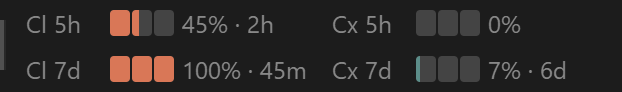

# Code Agent Usage Monitor


[](LICENSE)

Personal side project: a lightweight Windows taskbar widget for tracking code-agent rate limits, with Claude and Codex side by side.

This is a fork of Code Zeno Pty Ltd's [Claude Code Usage Monitor](https://github.com/CodeZeno/Claude-Code-Usage-Monitor). I did not create the original app. The fork tracks upstream, keeps its MIT license, and adds its own default layout, data-source fixes, and packaging.



## Features

- **Columns** layout by default: `Cl 5h`/`Cl 7d` and `Cx 5h`/`Cx 7d` rows with segmented bars and countdowns such as `45% · 2h`, one column per enabled provider in that vendor's colour
- Claude Code, Codex, Google Antigravity, OpenCode Go, Cursor, Grok Build, GitHub Copilot, and Meta Muse Code, with multiple accounts for Claude Code and Codex
- Paid credit tracking for Claude and Codex
- Taskbar docking with drag, snap, and lock; floating mode; multi-monitor; tray icons
- Settings dashboard, Theme Studio, other built-in themes, and 14 languages

See the [user guide](USER_GUIDE.md) for settings and themes, and the [changelog](CHANGELOG.md) for history.

## Requirements

- Windows 10 or 11
- At least one supported provider signed in. No CLI is needed: Claude Desktop and the ChatGPT desktop app logins are enough for Claude and Codex.

## Usage

Download `code-agent-usage-monitor.exe` from [Releases](https://github.com/jacobdwyer16/code-agent-usage-monitor/releases) and run it. `--dashboard` opens settings directly. Right-click the widget or a tray icon for refresh, update frequency, providers, and the dashboard.

The updater checks this repository's releases only; see [updater verification](docs/updater.md).

Theme authors can bind `.display` values, such as `{claude.session.display:usage_line}`, to follow the used/remaining setting. Warning thresholds should keep using `.percentage`.

### Upgrading from 1.x

Settings in `%APPDATA%\CodeAgentUsageMonitor` are read in place. Tracker visibility becomes the provider toggles and the refresh interval is kept. A dragged widget's offset moves into an editable **Migrated Theme**; otherwise the built-in Columns theme is used.

## Data sources

**Claude.** Credentials come from the Claude Code CLI (Windows or WSL) or Claude Desktop's encrypted token cache, decrypted in memory. Usage comes from Anthropic's OAuth usage endpoint, falling back to Messages API rate-limit headers. An idle window (0%, no reset) is never probed, since a probe would start it.

**Codex.** Usage comes from `chatgpt.com/backend-api/wham/usage` with the tokens in `~/.codex/auth.json`. A rejected token is refreshed through OpenAI's OAuth endpoint and written back to `auth.json`, with the Codex CLI as a fallback. When the service is unreachable, the newest snapshot in `~/.codex/sessions` is shown as earlier figures.

**Other providers.** Sign in with each provider's app or CLI, then enable it in **Providers**:

| Provider | Credentials |
| --- | --- |
| Google Antigravity | Antigravity sign-in |
| OpenCode Go | `OPENCODE_GO_WORKSPACE_ID` and `OPENCODE_GO_AUTH_COOKIE`, or `%APPDATA%\opencode-go\config.json` with `workspaceId` and `authCookie` (the `__Host-console_session` cookie) |
| Cursor | Local Cursor session, or `CURSOR_SESSION_TOKEN` |
| Grok Build | `grok login` (`%USERPROFILE%\.grok\auth.json`, or `GROK_HOME`); an API key alone is not enough |
| GitHub Copilot | `COPILOT_GITHUB_TOKEN`, `GH_TOKEN`, `GITHUB_TOKEN`, the Copilot CLI, or `gh auth login` |
| Meta Muse Code | `muse login` (`~/.config/muse/auth.json`, or `MUSE_CONFIG_DIR`); an API key from `muse auth set` is not enough |

Grok and Copilot report one pool per billing period, so they use the long-window row only. Muse Code omits its usage while the 5-hour window is idle, so that row reads 0% and the weekly row stays blank until the next request.

## Privacy

Requests go straight to each provider. There is no backend and no telemetry. Credential files are never modified, except that a refreshed Codex token is written back to `auth.json`.

## Troubleshooting

Hover a tray icon for the latest error, or check **Settings > Providers > Accounts**. `--diagnose` writes `%TEMP%\code-agent-usage-monitor.log`; redact credentials before sharing it.

## Build

```powershell
cargo build --release
```

Rust 1.95.0 is pinned in `rust-toolchain.toml`. To pull in upstream releases, `git fetch upstream` then `git merge upstream/main`. The `upstream` remote does not fetch tags, so upstream tags never collide with this fork's.

## License

MIT. See [LICENSE](LICENSE). Report vulnerabilities as described in [SECURITY.md](SECURITY.md).
